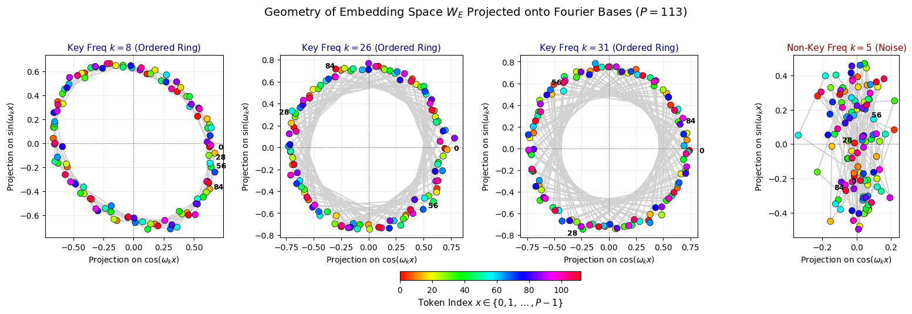
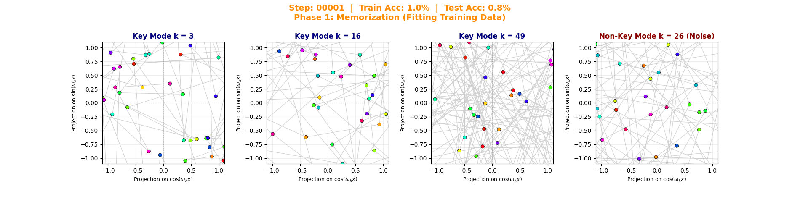
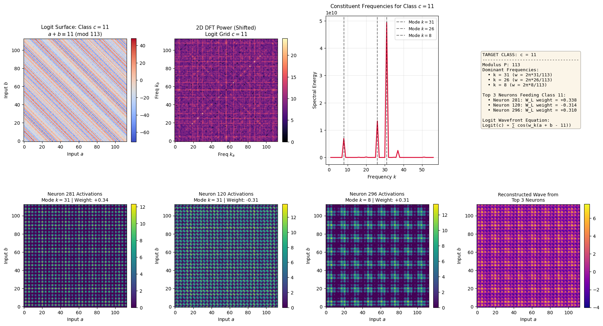
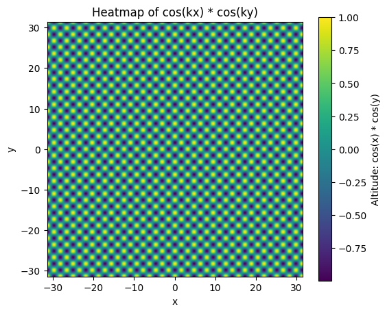
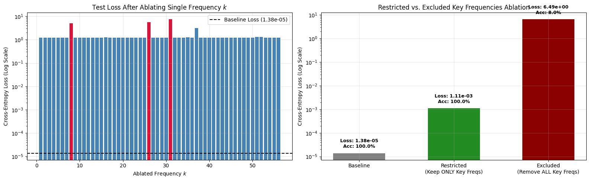

# Grokking 


**Inspired by the research of Neel Nanda and Team at Google Deepmind**
**Paper** : https://arxiv.org/abs/2301.05217 
**Welch Labs Explainatory video** : https://youtu.be/D8GOeCFFby4?si=bD_haDAMekB57V4w

## What is Grokking ?

Grokking in Machine Learning is a counter-intuitive phenomenon where-in a model is severely overfitted on it's training data , it memorises the training data (training loss nears 0 but the validation loss increases). However after many epochs the model undergoes a sudden generalisation. Validation loss also drops to near 0 . 

The phenomenon was first discovered and named by OpenAI researchers Alethea Power et al. in their January 2022 paper, "Grokking: Generalization Beyond Overfitting on Small Algorithmic Datasets. 


# Reimplementing "Progress Measures for Grokking via Mechanistic Interpretability"

This document describes my implementation and reproduction of the core findings from
Nanda et al. (2023), *Progress Measures for Grokking via Mechanistic Interpretability*
(ICLR 2023). The goal was to train a small transformer on modular addition, reproduce
the grokking phenomenon, and reverse-engineer the "Fourier multiplication" algorithm
the network learns.

## 1. Task and Architecture

The task is modular addition: given `a, b ∈ {0, ..., P-1}` for prime `P = 113`, predict
`c = (a + b) mod P`. Inputs are formatted as a 3-token sequence `[a, b, "="]`, and the
model is trained to predict `c` from the residual stream at the `"="` position.

I implemented a single-layer transformer (`GrokkingTransformer`) closely following the
paper's mainline architecture:

- **Token embedding** `W_E`: `(P+1) × d_model`, `d_model = 128`
- **Learned positional embedding** `W_pos`: one vector per sequence position (3 positions)
- **Multi-head attention**: `n_heads = 4`, `d_head = d_model / n_heads = 32`, with
  separate `W_Q`, `W_K`, `W_V`, `W_O` per head (no causal mask needed, only 3 tokens)
- **MLP**: a single ReLU hidden layer, `W_in: d_model → d_mlp` (`d_mlp = 512`),
  `W_out: d_mlp → d_model`, added back into the residual stream
- **Unembedding** `W_U`: `d_model → P`, applied to the residual stream at the `"="` token

Logits are read from the final-token residual stream after the attention + MLP block, i.e.
`Logits(a,b) = W_U · (x_attn + MLP(x_attn))`, mirroring the paper's convention that
`Logits(a,b) ≈ W_U W_out MLP(a,b)` once the residual/skip term is included.

The `forward` method optionally returns intermediate activations (`mlp_act`,
`attn_weights`) so that later interpretability tooling can probe the network without
re-implementing the forward pass.

## 2. Training Setup

Following the paper's mainline configuration:

- **Data**: all `P × P = 12,769` pairs, split with `train_frac = 0.3` (30% train / 70% held-out test)
- **Optimizer**: AdamW, `lr = 1e-3`, `betas = (0.9, 0.98)`, `weight_decay = 2.0`
- **Loss**: cross-entropy over the `P` output classes
- **Epochs**: 60,000, full-batch gradient descent on the training split
- **Checkpoints**: activations and weight-spectra snapshotted at epochs
  `{500, 3000, 8000, 20000, 30000, 40000, 60000}` for later visualization of training dynamics

At each checkpoint I cache:
1. The 1D Fourier norms of `W_E` (embedding matrix) and `W_L = W_U W_out` (neuron-logit map)
2. The full `(a, b)` logit grid for class `c = 0`
3. The activation grid of neuron 0 across all `(a, b)` pairs
4. Test loss / test accuracy

This reproduces Figure 7 of the paper — tracking sparsification of `W_E`/`W_L` in the
Fourier basis and the emergence of the periodic/diagonal logit structure over training.

## 3. Reproducing Grokking

Training exhibits the expected grokking curve: train accuracy reaches ~100% almost
immediately while test accuracy stays near chance (~28–31%) through epoch ~8,000, then
sharply transitions to 100% test accuracy by epoch ~20,000 and remains there through
60,000 epochs. This matches Figure 2 of the paper (train/test loss and accuracy over
training).

Across checkpoints, the `W_E` and `W_L` Fourier spectra evolve from diffuse/noisy
(dense across all frequencies, low accuracy) to sparse, with a handful of dominant
frequency spikes once the model generalizes — direct evidence that the network is
moving from a memorizing solution to a Fourier-structured generalizing one. The
`Logit(c=0)` heatmap over `(a, b)` similarly evolves from a noisy grid into clean
diagonal stripes satisfying `a + b ≡ 0 (mod 113)`, visually confirming the "rotate onto
a circle and read off the diagonal" mechanism described in the paper.

A separate single-neuron 2D DFT analysis (magnitude spectrum + diagonal energy
projection) automatically extracts the dominant frequency driving a given neuron's
activation pattern (e.g. a peak at `k = 37` for the fully-trained final model), and a
text summary panel restates the mechanistic decomposition:

```
W_E projects a, b to cos/sin(w_k * x)
MLP forms cos(w_k(a+b)) via:
    cos(w_k a)cos(w_k b) - sin(w_k a)sin(w_k b)
W_L reads off cos(w_k(a+b - c))
    giving the diagonal line a + b ≡ c (mod P)
```

## 4. Per-Class Mechanistic Inspection

I built a `ModularArithmeticInspector` class that runs a single forward pass over the
full `P × P` input grid and caches all logits and MLP activations, then supports
targeted analysis of any output class `c`:

- **Logit surface**: the `(a, b)` heatmap of `Logit(c)`, which should be maximized along
  the diagonal `a + b ≡ c (mod P)`
- **2D DFT of the logit surface**: confirms the surface is sparse in frequency space
- **1D constituent-frequency spectrum**: extracts the dominant `k`'s driving that class,
  by summing power along the `(k, k)` / `(P-k, P-k)` / `(k, P-k)` / `(P-k, k)`
  diagonal/anti-diagonal bins of the 2D spectrum (these are exactly the bins where a
  `cos(w_k(a+b))`-type signal concentrates its energy)
- **Top-k contributing neurons**: ranks MLP neurons by `|W_L[c, neuron]|` and plots
  their individual `(a, b)` activation grids alongside their dominant frequency
- **Reconstructed wavefront**: a weighted sum of the top-k neurons' activations
  (weighted by their `W_L` contribution), which visually reproduces the checkerboard/grid
  interference pattern responsible for the diagonal logit stripe

Running this on class `c = 11` for the trained model surfaces three dominant
frequencies (`k = 31, 26, 8`) and the three MLP neurons most responsible for that
class's logit (Neurons 281, 120, 296), each concentrated at one of those frequencies.
Summing their weighted activations reconstructs a clear diagonal wavefront consistent
with `a + b ≡ 11 (mod 113)` — directly reproducing the paper's Figure 4/Table 1-style
analysis, but automated per-class rather than hand-derived.

## 5. Embedding Geometry

`visualize_embedding_geometry` projects the trained embedding matrix `W_E` onto the 2D
subspace spanned by `cos(w_k x)` and `sin(w_k x)` for a chosen frequency `k`, for every
token `x ∈ {0, ..., P-1}`. For each of the key frequencies (`k = 8, 26, 31`), the tokens
land almost exactly on a circle in this projection, ordered by token index — i.e. `W_E`
really has learned to place tokens at angle `2πkx/P` around a circle, one circle per key
frequency. Projecting onto a **non-key** frequency (`k = 5`) instead gives an unordered
scatter with no ring structure, confirming that circular structure is specific to the
frequencies the model actually uses, not an artifact of the projection method.

## 6. Fourier Ablations (Causal Verification)

To verify that the identified frequencies are *actually used* by the model (rather than
just correlated with its output), I implemented `run_fourier_ablation_experiment`,
which:

1. Computes the full `(a, b) → logits` grid and takes a 2D FFT of it over the input
   dimensions
2. **Single-frequency ablation**: zeroes out one frequency `k` at a time (its four
   symmetric bins) and re-measures test loss/accuracy — done independently for every
   `k = 1..56`
3. **Restricted loss**: keeps *only* the key frequencies (`k ∈ {8, 26, 31}`, plus the DC
   term) and zeroes everything else, then measures loss
4. **Excluded loss**: the complementary ablation — zeroes out *only* the key
   frequencies and keeps everything else

**Results:**

| Condition | Loss | Accuracy |
|---|---|---|
| Baseline (unablated) | 1.38 × 10⁻⁵ | 100.0% |
| Restricted (keep only key freqs) | 1.11 × 10⁻³ | 100.0% |
| Excluded (remove all key freqs) | 6.49 × 10⁰ | 8.0% |

Ablating any single key frequency (`k = 8, 26, 31`) causes a large loss spike (visible as
red bars against a flat baseline in the per-frequency ablation plot), while ablating any
of the other ~95% of frequencies leaves performance essentially unchanged. Keeping
*only* the three key frequencies barely hurts performance (still 100% accuracy),
while removing *only* those three frequencies destroys performance (8% accuracy, near
chance). This is a direct, causal confirmation — independent of the earlier
correlational/geometric analysis — that the model's generalizing solution really is
carried by this sparse set of Fourier frequencies, reproducing the paper's Figure 6 and
Section 4.4 ablation results.

# Results of our implementation and a deep dive of Grokking 

## Embedding space  

when a model is about to grok , it's embedding layer starts to learn to map input x (one hot encoded over all 113 values) to a vector with 

$$(W_E t_x)_i \approx \sum_{k \in \mathcal{K}} A_{i, k} \cos(\omega_k x + \phi_{i, k})$$

The model uses certain freqeuncies (key frequencies).

To probe the ordering in the embedding space we do the following procedure : 

1. Define the 1D Fourier Basis Vectors across Tokens 

$$\mathbf{b}_{\cos, k} = \sqrt{\frac{2}{P}} \begin{bmatrix} \cos(\omega_k \cdot 0) \\ \cos(\omega_k \cdot 1) \\ \vdots \\ \cos(\omega_k \cdot (P-1)) \end{bmatrix} \in \mathbb{R}^P, \quad \mathbf{b}_{\sin, k} = \sqrt{\frac{2}{P}} \begin{bmatrix} \sin(\omega_k \cdot 0) \\ \sin(\omega_k \cdot 1) \\ \vdots \\ \sin(\omega_k \cdot (P-1)) \end{bmatrix} \in \mathbb{R}^P$$

where $\omega_k = \frac{2\pi k}{P}$.

2. Project the Fourier Basis Vectors from token space to embedding space 

$$\begin{aligned}
\mathbf{v}_{\cos, k} &= \mathbf{b}_{\cos, k}^T W_E \in \mathbb{R}^{128} \\
\mathbf{v}_{\sin, k} &= \mathbf{b}_{\sin, k}^T W_E \in \mathbb{R}^{128}
\end{aligned}$$

and also normalise them 

$$\hat{\mathbf{u}}_k = \frac{\mathbf{v}_{\cos, k}}{\Vert{}\mathbf{v}_{\cos, k}\Vert{}_2} \in \mathbb{R}^{128}, \quad \hat{\mathbf{v}}_k = \frac{\mathbf{v}_{\sin, k}}{\Vert{}\mathbf{v}_{\sin, k}\Vert{}_2} \in \mathbb{R}^{128}$$

3. Then project any vector x from the embedding space ($\mathbb{R}^{128}$) onto the vectors 

$$\hat{\mathbf{u}}_k \quad \text{and} \quad \hat{\mathbf{v}}_k$$

*Result* of projections (with a few values of k is as follows) 



### A small dummy example as to why plots with k = 8 , 26 , 31 are structurally ordered 

Suppose $P = 7$, $k = 2$, $\omega_2 = \frac{4\pi}{7}$, and $d_{\text{model}} = 4$:

And say the embedding layer has learnt to represent 

$$W_E \mathbf{e}_x = W_E[x] = \begin{bmatrix} \cos(\omega_k \cdot x) \\ \sin(\omega_k \cdot x) \\ 0 \\ 0 \end{bmatrix}$$

$$W_E = \begin{bmatrix} \cos(0 \cdot \omega_2) & \sin(0 \cdot \omega_2) & 0 & 0 \\ \cos(1 \cdot \omega_2) & \sin(1 \cdot \omega_2) & 0 & 0 \\ \cos(2 \cdot \omega_2) & \sin(2 \cdot \omega_2) & 0 & 0 \\ \cos(3 \cdot \omega_2) & \sin(3 \cdot \omega_2) & 0 & 0 \\ \cos(4 \cdot \omega_2) & \sin(4 \cdot \omega_2) & 0 & 0 \\ \cos(5 \cdot \omega_2) & \sin(5 \cdot \omega_2) & 0 & 0 \\ \cos(6 \cdot \omega_2) & \sin(6 \cdot \omega_2) & 0 & 0 \end{bmatrix} = \begin{bmatrix} +1.000 & 0.000 & 0 & 0 \\ -0.222 & +0.975 & 0 & 0 \\ -0.901 & -0.434 & 0 & 0 \\ +0.623 & -0.782 & 0 & 0 \\ +0.623 & +0.782 & 0 & 0 \\ -0.901 & +0.434 & 0 & 0 \\ -0.222 & -0.975 & 0 & 0 \end{bmatrix}$$

Define the Fourier Basis Vectors $\mathbf{b}_{\cos, 2}, \mathbf{b}_{\sin, 2} \in \mathbb{R}^7$

$$\mathbf{b}_{\cos, 2} = \sqrt{\frac{2}{7}} \begin{bmatrix} \cos(0 \cdot \omega_2) \\ \cos(1 \cdot \omega_2) \\ \cos(2 \cdot \omega_2) \\ \cos(3 \cdot \omega_2) \\ \cos(4 \cdot \omega_2) \\ \cos(5 \cdot \omega_2) \\ \cos(6 \cdot \omega_2) \end{bmatrix} = \sqrt{\frac{2}{7}} \begin{bmatrix} +1.000 \\ -0.222 \\ -0.901 \\ +0.623 \\ +0.623 \\ -0.901 \\ -0.222 \end{bmatrix}, \quad  \mathbf{b}_{\sin, 2} = \sqrt{\frac{2}{7}} \begin{bmatrix} \sin(0 \cdot \omega_2) \\ \sin(1 \cdot \omega_2) \\ \sin(2 \cdot \omega_2) \\ \sin(3 \cdot \omega_2) \\ \sin(4 \cdot \omega_2) \\ \sin(5 \cdot \omega_2) \\ \sin(6 \cdot \omega_2) \end{bmatrix} = \sqrt{\frac{2}{7}} \begin{bmatrix} 0.000 \\ +0.975 \\ -0.434 \\ -0.782 \\ +0.782 \\ +0.434 \\ -0.975 \end{bmatrix}$$

Compute the Direction Vectors in 4D Space ($\mathbf{v}_{\cos}, \mathbf{v}_{\sin} \in \mathbb{R}^4$)
$\mathbf{v}_{\cos} = \mathbf{b}_{\cos, 2}^T W_E$:

$$\hat{\mathbf{u}} = \frac{\mathbf{v}_{\cos}}{\Vert{}\mathbf{v}_{\cos}\Vert{}_2} = \frac{\begin{bmatrix} \sqrt{7/2} & 0 & 0 & 0 \end{bmatrix}}{\sqrt{7/2}} = \begin{bmatrix} 1 \\ 0 \\ 0 \\ 0 \end{bmatrix}$$

similarly , 
$$\hat{\mathbf{v}} = \frac{\mathbf{v}_{\sin}}{\Vert{}\mathbf{v}_{\sin}\Vert{}_2} = \begin{bmatrix} 0 \\ 1 \\ 0 \\ 0 \end{bmatrix}$$

When we project x fromt the embedding space onto u and v we get 
$$X_x = W_E[x] \cdot \hat{\mathbf{u}} = \begin{bmatrix} \cos(\omega_2 x) & \sin(\omega_2 x) & 0 & 0 \end{bmatrix} \begin{bmatrix} 1 \\ 0 \\ 0 \\ 0 \end{bmatrix} = \mathbf{\cos(\omega_2 x)}$$
$$Y_x = W_E[x] \cdot \hat{\mathbf{v}} = \begin{bmatrix} \cos(\omega_2 x) & \sin(\omega_2 x) & 0 & 0 \end{bmatrix} \begin{bmatrix} 0 \\ 1 \\ 0 \\ 0 \end{bmatrix} = \mathbf{\sin(\omega_2 x)}$$

Hence a ordered structure . 

had you used a non key frequency , we would have gotten $\mathbf{v}_{\cos} = \mathbf{b}_{\cos, 1}^T W_E$ = 0 and similarly for the sin part . All we would have left is some random noise .


**On another training run** with weight decay = 1.5 , 35k training steps we identify key frequencies {3 , 16 , 49}. There evolution over training steps is as follows 




## Attention layer and MLP 

The attention layer and MLP use a clever trignometric identity :
$$\cos(a + b) = \cos a \cos b - \sin a \sin b $$

The attention layers and MLP layers first learn to approximate the functions like product of sines and cosines . 



The second graph of the first row represents how dominant are frequency pairs (f_a , f_b).

Here is the heatmap of a function cos(kx) * cos(ky) 




Then these products are weighted and added to create terms of the form cos(k(x+y)) which attains maximum at x+y mod 113 = some constant . 

## Results of Frequency ablation  

### Ablation of non key frequencies 



When we ablate (zero out) key frequencies the accuracy drops by a large large margin (down to 8%) . where as zeroing out non key frequencies does not affect the performance hence prooving that the model needs only a few frequencies to solve the modular addition problem . 


